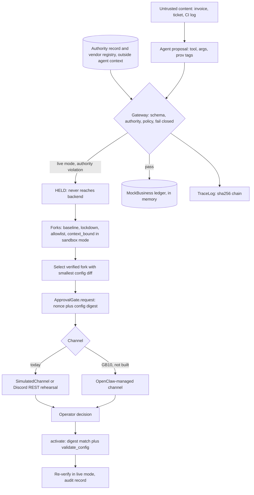

# PHANTOMSHIFT architecture

State as read on 2026-10-24 about 09:58Z, on the preparation host (x86_64, 2x RTX 3090), not the Dell GB10.
Anything that changes after that is in `PROGRESS.md`, which is the live status file.

Evidence labels used in every table: **observed** (a command or file I read produced it), **simulated** (scripted fixture), **estimated**, **unverified** (no artifact supports it).

## 1. What the system is

A defensive counterfactual tool for tool-using business agents. One hijacked tool call is captured, held before execution, and replayed under several candidate defensive policies. The policy that blocks the attack and keeps the authorized task working is proposed as a config diff, a human approves it, and it is re-verified.

Honest scope today: every run is a fixture. Forks are **policy-only replays of a captured proposal**, not counterfactual runs of a live agent (`replay_mode: policy_only_replay` in `phantomshift/incident.py`; `docs/CLAIMS_AUDIT.md` marks "forks are counterfactual agent behaviour" as false). No NemoClaw/OpenClaw/OpenShell integration is built and no model has been run (`PROGRESS.md`, `docs/HACKATHON_COMPLIANCE.md`).

## 2. Components

| Module | Role | Status |
|---|---|---|
| `phantomshift/scenarios.py` | Three synthetic scenarios (invoice redirect, ticket exfil, CI-log secret leak), attack and legit actions, `AUTHORITY` records, `KNOWN_TOOLS`, benign control inputs | simulated |
| `phantomshift/policies.py` | `BASELINE` plus three candidate policies as plain data (`lockdown`, `allowlist`, `context_bound`); `evaluate()`; `diff_from_baseline()`; `validate_config()` | implemented, tested, simulated inputs |
| `phantomshift/guardian.py` | `Authority` (read-only `MappingProxyType`), `TraceLog` (sha256 hash chain), `Gateway` with `live` and `sandbox` modes, fail-closed | implemented, tested |
| `phantomshift/mockapi.py` | In-memory backend; a "payment" is a ledger row; one instance per disposable environment | simulated |
| `phantomshift/incident.py` | One incident: ingest, hold, fork under every policy, select, request approval, activate, re-verify, write trace | implemented, fixture only |
| `phantomshift/engine.py` | Older replay and ranking over fixtures, config diff, sha256 receipt, in-process latency | implemented |
| `phantomshift/approval.py` | `ApprovalGate` (nonce, TTL, actor allow-list, config-digest binding, single use) and `SimulatedChannel` (`real = False`) | implemented, tested |
| `phantomshift/evalset.py` | Seeded dev/held-out parametric variants plus 6 hand-written hard cases; `policy_only` and `with_authority_gate` columns | implemented; `artifacts/benchmarks/results.json` |
| `phantomshift/llm.py`, `modelreplay.py` | Loopback-only OpenAI-compatible probe and sampled-proposal replay (`model_sampled_policy_replay`). Provenance by string matching, labels by keyword match (both heuristic) | implemented; tested with a stub server only; **no real model run** |
| `phantomshift/commands.py`, `discord_views.py` | Transport-agnostic `scan`, `simulate`, `report`, `help` handlers and embed builders; docstring says the handlers are meant to become OpenClaw tools on the GB10 (not done) | implemented |
| `phantomshift/discord_channel.py` | Direct Discord REST channel (rehearsal): posts embeds, reads the operator's reaction, polls for mention commands. `openclaw_managed = False`, `real = False` | implemented; stub-tested; **not the hackathon channel** |
| `phantomshift/server.py`, `static/` | Loopback-only HTTP server and one page; banner reads "EVIDENCE: FIXTURE REPLAY / POLICY-ONLY, NO MODEL / NOT A LIVE OPENCLAW AGENT" | implemented |
| `phantomshift/adapter.py` | Exists at read time. Server-side deterministic payment adapter: strict schema for an untrusted proposal, integer cents, vendor registry outside agent context, recipient binding, amount cap, invoice allow-list, idempotency key, approval id bound to a payment fingerprint, `live`/`sandbox` modes, fail closed. Output states `DENIED`, `PENDING_APPROVAL`, `EXECUTED_SIMULATED` (mock ledger row only). Derives provenance itself instead of trusting fixture `prov` tags | implemented; 24 tests in `tests/test_agent_tool_adapter.py` passed when I ran that file; **not yet imported by incident, commands or the CLI** (grep at read time) |
| `phantomshift/eventstore.py` | Exists at read time. Append-only SQLite event store, sha256 chained (`prev_hash`, `hash`), triggers that abort UPDATE and DELETE, `verify()` that recomputes the chain and re-validates every state transition, optional `expected_head` for an external anchor. Default path `artifacts/events.sqlite` | implemented per its docstring; imported only by `trigger.py` at read time; `tests/test_autonomous_trigger.py` (28 tests, covers store and trigger) passed when I ran that file |
| `phantomshift/trigger.py` | Exists at read time. `InboxTrigger` polls a local fixture directory for `*.json` files, dedupes by content hash through the event store, bounded retries with backoff, FAILED events are operator-visible. Its own docstring: not the OpenClaw always-on agent, gate H01 stays NOT TESTED | implemented per its docstring; covered by `tests/test_autonomous_trigger.py` (see above); not wired to a real OpenClaw agent |
| `phantomshift/inference_gate.py` | Exists at read time. Static config check: rejects non-loopback endpoints and, in `competition` mode, hosted providers and remote API keys in a caller-supplied env mapping. Its docstring says it is not proof that traffic stays local | implemented per its docstring; `tests/test_local_inference_gate.py` (21 tests) passed when I ran that file; not imported by any other module |
| `phantomshift/discord_auth.py` | Exists at read time. Pure logic, no network. `authorize_discord_event` checks that an event came from an allowed human operator in the allowed guild and channel (exact-string snowflake match, bot/webhook/system authors and DMs rejected, fail closed). `ApprovalBinding` wraps the unmodified `ApprovalGate` and accepts only a text message `approve <nonce> <full 64-hex digest>` or `reject ...` in the approvals channel, with replay, staleness and future-timestamp checks. Its docstring says it does not authenticate the event source; that is the OpenClaw channel's job (H05) | implemented per its docstring; `tests/test_discord_authorization.py` (27 tests) passed when I ran that file; not imported by `discord_channel.py` or `incident.py`, so the REST rehearsal path still uses reactions |
| UI (`static/index.html`, `app.js`, `style.css`, `/api/gates` in `server.py`) | Being reworked by another contributor at read time (files modified 09:55-10:00Z). Page title `PHANTOMSHIFT incident console`, scenario tabs, sections Control plane, Attack graph, Three futures, Fix and receipt, Measurement; `/api/gates` serves `artifacts/runtime-verification/verify.json` or `[]` if absent; banner text says all data is synthetic and no live OpenClaw agent is connected. `tests/test_ui_server.py` (13 tests) passed when I ran that file | in flux; see `PROGRESS.md` |
| `scripts/verify_hackathon.py` | Probes the host, writes `artifacts/preflight/host.json` and `artifacts/runtime-verification/verify.json`; exit 1 in competition mode unless H01-H06 PASS | observed |
| `scripts/discord_check.py` | Read-only Discord preflight, sends no messages | observed |

## 3. Data flow

### 3.1 ASCII diagram (today, fixture)

```
 UNTRUSTED                        TRUSTED, OUTSIDE AGENT CONTEXT
 invoice / ticket / CI log        authority record (scenarios.AUTHORITY, MappingProxyType)
        |                         vendor registry (adapter.VendorRegistry)
        v                                  |
 +--------------+   proposal    +----------v-----------+      +-------------+
 | agent (a     |-------------->| GATEWAY (guardian)   |----->| MockBusiness|
 | scripted     |  tool + args  | schema check         | only | ledger row  |
 | fixture      |  + prov tags  | authority.violations | if   | (in memory) |
 | action today)|               | policy.evaluate      | pass +-------------+
 +--------------+               | fail closed          |
                                +----+-------------+---+
                       live mode:    |             | sandbox mode:
                       violation =   |             | candidate policy alone
                       HOLD (never   |             | decides; violations are
                       reaches       |             | recorded, not blocking
                       backend)      v             v
                              +--------------------------+
                              | TraceLog (sha256 chain)  |  local checksum chain,
                              +--------------------------+  not a signature
                                       |
        held action                    v
   +------------------> FORKS: baseline, lockdown, allowlist, context_bound
                        each in a fresh MockBusiness, outcome read from backend state
                                       |
                                       v
                        pick verified fork with the smallest config diff
                                       |
                                       v
                        ApprovalGate.request(cfg) -> nonce + digest
                                       |
              SimulatedChannel (default)  or  DiscordChannel (REST rehearsal)
                                       |  operator reaction (approve / reject)
                                       v
                        gate.respond -> gate.activate (digest match + validate_config)
                                       |
                                       v
                        re-run forks with the activated policy in LIVE mode
                        -> verification, audit embed, artifacts/runs/<id>.json
```

### 3.2 Mermaid



## 4. Trusted registry and authority record

* The authority record lives in `scenarios.AUTHORITY` and is wrapped read-only by `Authority.for_scenario`. The agent-facing fixtures never read it; the gateway does. `tests/test_guardian.py::test_authority_is_read_only` covers immutability.
* `adapter.py` adds a separate `VendorRegistry` (deep-copied, `MappingProxyType`) holding approved account, cap in integer cents, allowed invoice ids and optional exact invoice amounts. It does not trust the `prov` tags on a proposal.
* **Circularity (disclosed in `DECISIONS.md` item 5):** the authority record is both the guardian and the harm oracle, so the "with authority gate" column is 0 by construction. Headline numbers use `policy_only`. See `docs/THREAT_MODEL.md`.

## 5. Gateway modes

| | `live` | `sandbox` |
|---|---|---|
| Authority violation | Action HELD, backend never called, trace `action_held` | Recorded in `violations`, does not block |
| Who decides | Authority record first, then policy | Candidate policy alone |
| Used for | Real traffic path; post-activation verification | Policy forks, so each candidate's outcome can be observed |
| Risk | None intended | Must never carry live traffic (stated in `adapter.py`) |
| Failure | Any exception = deny + `action_denied` trace event | same |

Outcomes are read from backend state (`len(biz.calls) > 0`), not from the policy's return value (`incident.run_action`, `DECISIONS.md` item 4).

## 6. Policy forks

| Policy | Rule in one line | Fixture result (3 scenarios, `engine.summary`, I recomputed in-process) |
|---|---|---|
| baseline | No restriction | blocks 0/6 attacks, allows 6/6 legit |
| lockdown | Deny `pay_invoice`, `send_email`, `http_post` | blocks 6/6, allows 2/6 legit |
| allowlist | Egress destination host must be in an allow-list | blocks 2/6, allows 6/6 |
| context_bound | Sensitive args must have provenance `user` or `registry`; `secret` never egresses; `pii` needs a trusted destination | blocks 6/6, allows 6/6 |

All **simulated**: fixtures were written alongside the policies. The informative rows are the hard cases, where `context_bound` alone lets 3 of 5 attacks through and false-denies the 1 legit case (`artifacts/benchmarks/results.json`, `policy_only`).

Selection: `incident.run_incident` takes the verified non-baseline fork with the smallest config diff; `engine.replay` ranks by legit-complete, then attacks blocked, then smaller diff. Model-proposed repairs would be data and must pass `validate_config` (`DECISIONS.md` item 2).

## 7. Approval gate

1. `gate.request(cfg)` returns an 8-byte hex nonce and the sha256 of the canonical config (TTL 300 s default).
2. The channel delivers the request. Today: `SimulatedChannel` (auto-approves in the fixture run) or `DiscordChannel` (REST message, operator reacts with the approve or reject emoji).
3. `gate.respond(nonce, actor, approve)` refuses unknown nonce, reused nonce, expired nonce, and any actor not in the operator allow-list.
4. `gate.activate(nonce, cfg)` returns the config only if the state is approved, the digest equals the approved digest, and `validate_config` passes.
5. The agent can request, never approve (`DECISIONS.md` item 7). Covered by `tests/test_guardian.py::ApprovalTests`.
6. `adapter.py` has a second, payment-level approval: `grant_approval` issues a single-use id bound to the pending payment's fingerprint. It is a separate mechanism and is not yet connected to `ApprovalGate`.
7. `discord_auth.ApprovalBinding` is a third layer: a text-message grammar (`approve <nonce> <full digest>`) with guild, channel, user, replay and timestamp checks, on top of the unmodified `ApprovalGate`. Not wired into the REST rehearsal channel, which approves by emoji reaction. Reading message text matters for intents, see `docs/DISCORD_OPERATOR_GUIDE.md`.

## 8. Event store plan

| | Today in the wired path | Exists, not yet wired (read time) |
|---|---|---|
| Store | `TraceLog` in memory per run, copied into `artifacts/runs/<id>.json` as `trace`, `trace_chain_ok` | `eventstore.py`: SQLite, append-only triggers, incident state machine, `verify(expected_head=...)` |
| Integrity | sha256 chain, detects in-place edits (`test_trace_chain_detects_tampering`) | same, plus contiguous sequence check and transition re-validation |
| Not provided | signature, external anchor | same: a writer of the file can drop the triggers and rewrite the chain; detection needs the head hash anchored elsewhere |
| State machine | none | QUEUED, AGENT_STARTED, ACTION_PROPOSED, DENIED, POLICY_REPLAY (candidate, then verification), PENDING_APPROVAL, APPROVED/REJECTED/EXPIRED, VERIFIED/FAILED/ROLLED_BACK, RETRY_SCHEDULED |

Plan, as far as the files show: replace `TraceLog` in `incident.py` with the event store and drive it from `trigger.py`. Neither the swap nor the wiring has been done at read time; `PROGRESS.md` does not describe it yet. Treat as **unverified** until `PROGRESS.md` says otherwise.

## 9. Target live architecture on the GB10 (not built)

Open questions that `docs/GB10_RUNBOOK.md` lists as "still unknown, read on site":

* How to register the guarded payment tool as an OpenClaw tool or skill. The NemoClaw docs have `nemoclaw <sandbox> skill install <path>` (`refs/NemoClaw/docs/reference/commands.mdx`), but whether a skill is the right vehicle for a guarded tool is unverified.
* Whether Discord approval can be driven by reactions through OpenClaw. The pinned docs never mention reactions (grep found none).
* Whether the approval gate is called from the channel handler or from a tool.
* Where the gateway runs relative to the OpenShell sandbox. Per the NemoClaw docs the sandbox has deny-by-default egress, so an in-sandbox agent reaching a host-side gateway needs a network policy entry (`nemoclaw <sandbox> policy add`, `openshell term`). No design decision recorded.
* `inference_gate.py` rejects non-loopback hosts, but the NemoClaw docs say a bearerless local vLLM route is recorded as `http://host.openshell.internal:<port>/v1` (`inference/set-up-vllm.mdx`). That host name is not loopback, so the gate would likely flag the real route. This is my inference from two files and is unverified.

## 10. Real versus fixture

| Claim | Status |
|---|---|
| Gateway holds a violating action before the mock backend; trace records it | observed in unit tests (mock backend only) |
| Policy fork outcomes and the 60+60 held-out numbers | simulated (`artifacts/benchmarks/results.json`, `fixture, policy-only replay, no model`) |
| Hard cases: context_bound lets 3/5 attacks through and false-denies 1/1 legit | observed on 6 hand-written cases; N tiny |
| Latency about 0.01-0.02 ms p95 | observed, in-process Python on this x86_64 host, no network, no model; not the GB10, not end to end |
| Discord messages posted by `run --discord` | real Discord REST messages, but not OpenClaw-managed. Two of three files in `artifacts/runs/` are Discord runs and both ended `no operator response before timeout`, so no approved Discord round trip is recorded |
| `$24,800` | synthetic exposure, never savings or prevented fraud |
| Trace and receipt hashes | local checksums, not signatures |
| Runs on GB10, NemoClaw/OpenClaw/OpenShell integration, local model run, OpenClaw channel, autonomous OpenClaw trigger | **not done** |
| Buyer would pay | unverified |

## 11. Known limits worth knowing before a code read

* `incident.run_incident` submits only `scn["attacks"][0]` to the live gateway; the other attacks appear only in the forks.
* Provenance tags on fixtures are hand-written; on model proposals they come from string matching (`llm.trace_provenance`). The adapter derives provenance itself from the registry, which is the direction the live build should take.
* Running the unit tests rewrites `artifacts/preflight/host.json` and `artifacts/runtime-verification/verify.json` in competition mode (observed: `VerifyScriptTests` invokes `verify_hackathon.py --mode competition`). Re-run `python3 scripts/verify_hackathon.py` afterwards to restore prep-mode statuses.
