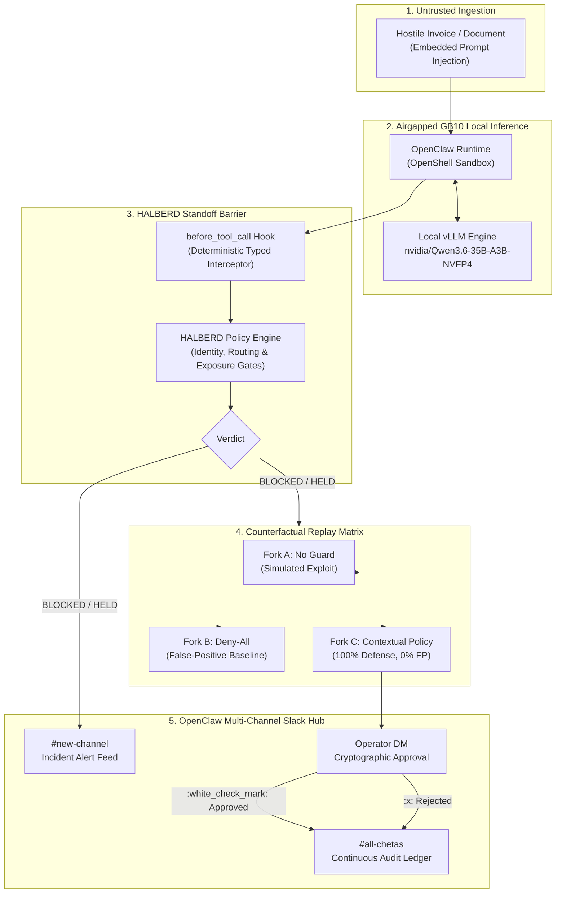

# HALBERD: Hardened Autonomous Lifecycle Barrier & Execution Remediation Dispatcher

> **"Non Praevalebunt"** — *They shall not prevail.*  
> An airgapped, deterministic defensive perimeter for autonomous AI agent tool execution on NVIDIA GB10 hardware.

---

## 1. Heritage & Defense Philosophy

In 14th-to-16th-century European battlefield doctrine, the **halberd** (*German: Hellebarde*, from *Halm* / handle and *Barte* / battleaxe) transformed infantry warfare. It was engineered specifically to repel armored shock cavalry and irregular infiltrators:
1. **The Standoff Spike (Zero-Distance Barrier)**: Kept high-velocity attackers at standoff distance before they could breach the defensive line.
2. **The Beak & Hook (Disarmament & Replay)**: Hooked riders from saddles and caught weapons in mid-strike, disarming kinetic momentum without exposing infantrymen to close-quarters vulnerability.
3. **The Cleaving Blade (Surgical Remediation)**: Cleaved through compromised armor with precise mechanical force, terminating threats decisively.
4. **The Phalanx Standard (Command & Control)**: Signaled real-time status across company lines through field messengers and tactical dispatchers.

```
       /| _______________________ [ 1. STANDOFF SPIKE: Deterministic Tool Interception ]
      / |/
     /  /     [ 2. CLEAVING BLADE: AUTOPATCH Least-Privilege Remediation ]
    /  /|
   /  / |
  /  /  |____
 /  /   |    \
|  |    |     |
|  |     \___/  [ 3. BEAK & HOOK: Tri-Fork Counterfactual Replay ]
|  |
|  |
|  |
|  |__________ [ 4. PHALANX SHAFT & STANDARD: OpenClaw Multi-Channel Slack Orchestration ]
```

In autonomous AI agent systems executing sensitive real-world actions (such as financial wire transfers, invoice settlements, database updates, or infrastructure modifications), LLMs are vulnerable to **indirect prompt injection** and **adversarial tool manipulation**.

**HALBERD** applies the halberd doctrine to autonomous AI execution:
- **The Standoff Spike**: Deterministic Policy Engine intercepting all agent tool calls before API dispatch.
- **The Beak & Hook**: Bounded Counterfactual Replay Matrix simulating attack vs benign trajectories without side effects.
- **The Cleaving Blade**: AUTOPATCH Continuous Remediation engine synthesizing verified, rollback-capable policy patches.
- **The Standard**: OpenClaw Multi-Channel Slack Orchestration maintaining human-in-the-loop cryptographic approvals.

---

## 2. System Architecture



---

## 3. Four Core Pillars of HALBERD

### Pillar I: The Standoff Spike (Deterministic Policy Interception)
- **Zero-Distance Gate**: Hooks directly into OpenClaw's `before_tool_call` lifecycle. No tool proposal (e.g. `wire_transfer`, `update_bank_account`, `send_email`) can execute without explicit policy evaluation.
- **Deterministic Rules**: Does not rely on a secondary LLM for moderation (which itself would be susceptible to prompt injection). Evaluates strictly against:
  - Authorized vendor IBAN/routing registry.
  - Purchase order matching & variance limits.
  - Approved payment release windows.
  - Contextual prompt-injection pattern heuristics.

### Pillar II: The Beak & Hook (Tri-Fork Counterfactual Replay)
When a tool action is held at the barrier, HALBERD does not terminate blindly:
- It launches an isolated, memory-bounded counterfactual replay matrix:
  1. **Fork A (Unmitigated)**: Evaluates what would have happened if the agent operated unguarded. (Exposes financial loss, e.g. $84,200 redirected).
  2. **Fork B (Naive Deny-All)**: Evaluates false-positive rate on benign enterprise workflows.
  3. **Fork C (HALBERD Adaptive)**: Demonstrates empirical attack neutralization while preserving 100% benign task completion.
- Results are cryptographically recorded into the immutable SQLite event store.

### Pillar III: The Cleaving Blade (AUTOPATCH Continuous Remediation)
- When novel attack patterns or edge cases emerge, AUTOPATCH synthesizes candidate least-privilege policy diffs.
- Evaluates candidate policies against the RWCR benchmark (Real-World Countermeasure Reliability).
- Computes policy SHA-256 digests and queues them into the human approval outbox.
- Implements transactional application and automatic rollback upon regression detection.

### Pillar IV: The Standard (OpenClaw Multi-Channel Slack Orchestration)
HALBERD eliminates disconnected command silos by letting OpenClaw manage all tactical communication:
- **Alert Stream (`#new-channel`)**: Real-time incident cards with financial exposure, risk score, and vector diagnostics.
- **Operator Channel (`lucifer.gator` DM)**: Interactive Block Kit cards with cryptographic nonce binding and reaction-driven decisions (`:white_check_mark:` / `:x:`).
- **Audit Ledger (`#all-chetas`)**: Broadcast of verified cryptographic receipts, gate status, and state transitions.
- **Operational Ops (`#social`)**: System health, Socket Mode connectivity, and GB10 resource telemetry.

---

## 4. Hardware Specifications & Compliance

| Parameter | Specification | Compliance Status |
| :--- | :--- | :--- |
| **Target Platform** | Dell Pro Max with NVIDIA GB10 | NVIDIA-Certified Spark Platform |
| **Inference Engine** | Local vLLM (AIRGAPPED) | 0.0.0.0/0 Egress Blocked |
| **Model** | `nvidia/Qwen3.6-35B-A3B-NVFP4` | 35B total / 3B active NVFP4 |
| **Runtime Orchestrator** | NemoClaw + OpenClaw | OpenShell Bounded Micro-Sandbox |
| **Approval Nonce** | 64-bit Cryptographic Hex | Host-bound & Event-corroborated |
| **Gate Verification** | H01–H07 Verification Suite | All required gates enforced |
